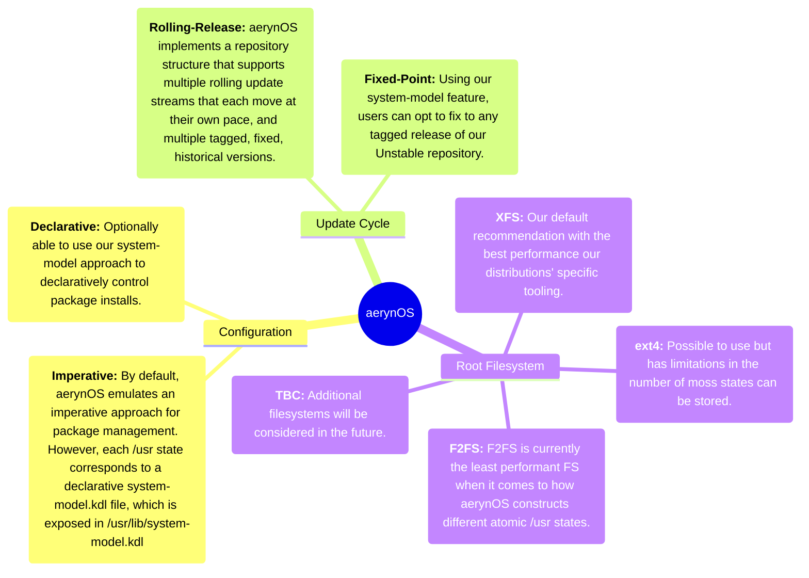

import { Card, CardGrid } from '@astrojs/starlight/components';
import { Image } from 'astro:assets';

> **To build modern, ergonomic, and high-performance tooling & infrastructure for distribution engineering. Use it to deliver an atomic operating system that is fast, predictable, reliable, and a joy to use and maintain.**
>
> — <cite>aerynOS Mission Statement</cite>

## Current state: Under development (Alpha)`

aerynOS is an in-development rolling release Linux distribution. Staff, Trusted Maintainers, Contributors and Early Adopters are "dogfooding" the distribution and its tooling with the explicit goal of iteratively improving it until it is fit for general use as a daily driver.

To this end, we currently maintain a deliberately small [package repository](https://github.com/aerynOS/recipes). Whilst this is slowly growing, it is a conscious decision to keep the repository size small until our foundational tooling and infrastructure is further developed. Having said that, we do try and offer a passable experience for adventurous Linux users who aren't afraid to report and/or help us fix any problems they encounter during daily use.

## Features

<CardGrid stagger>

  <Card title="Flathub Integration" icon="simple-icons:flathub">
    Get access to thousands of applications right out of the box with built-in [Flathub](https://flathub.org) support. Install your favourite apps with just a few clicks.
  </Card>

  <Card title="Choice of Modern Desktops" icon="fa6-solid:desktop">
    A choice of many different desktop environments from [Budgie](https://buddiesofbudgie.org/), [COSMIC](https://system76.com/cosmic), [GNOME](https://www.gnome.org/) and [KDE Plasma](https://kde.org/plasma-desktop/).
    
    In addition we offer many different Wayland Compositor environments such as [Gamescope](https://github.com/ValveSoftware/gamescope), [Hyprland](https://hypr.land/), [Jay](https://github.com/mahkoh/jay), [Labwc](https://labwc.github.io/), [Mangowm](https://mangowm.github.io/), [Miricle-WM](https://miracle-wm.org/), [Miriway](https://github.com/Miriway/Miriway), [Niri](https://niri-wm.github.io/niri/), [Sway](https://swaywm.org/) and [Weston](https://wayland.pages.freedesktop.org/weston/).

  </Card>

  <Card title="Developer Ready" icon="fa6-solid:code">
    To support our primarily developer focused userbase, we have packaged up various different tooling such as [Zed](https://zed.dev/) along with the LLM free variant, [Gram](https://gram-editor.com/). We also have many different command line tools packaged and available in the repository. These include [emacs](https://www.gnu.org/software/emacs/), [fresh](https://getfresh.dev/), [helix](https://helix-editor.com/), [kakoune](https://kakoune.org/), [micro](https://micro-editor.github.io/), [vim](https://www.vim.org/) and [vscode](https://code.visualstudio.com/).
  </Card>
</CardGrid>

## How the pieces fit together

aerynOS is the collective output of brand new tooling and associated processes, engineered from the ground up to deliver a Linux distribution that focuses on reliability, up front predictability, proven performance and efficiency.

Our ground up approach has enabled us to provide atomic updates without requiring reboots or having to utilise containers for package delivery. Part of our design philosophy is to deliver "just enough" flexibility and customisability to end users, without becoming a meta-distribution, and without compromising on predictability or reliability.

## Meet the team

The aerynOS team is a diverse group of individuals from different backgrounds, geographic locations and skill-sets. We treat each other with respect and understanding, and we work together to create a positive and inclusive environment. In all areas, we encourage contributors and staff to play around, experiment and make mistakes in order to "fail forward"; in aerynOS, making mistakes / derps / booboos / oopsies is considered nature's most efficient learning tool.

Whenever we recruit new team members, we start by sharing our foundational values with them:

> ***Be kind, foster joy, listen, care.***
>
> — <cite>aerynOS Foundational Values</cite>

## Active staff members

<CardGrid>
  <Card title="ermo">
    <Image src="/images/authors/ermo.webp" alt="ermo" class="avatar-img" width={80} height={80} />
    **Project Steward and Co-founder**  
    Focuses on setting the direction for the project.  
    [GitHub](https://github.com/ermo)
  </Card>

  <Card title="tarkah">
    <Image src="/images/authors/tarkah.webp" alt="khaga87" class="avatar-img" width={80} height={80} />
    **Staff Developer and Rust enthusiast**  
    Primary code developer with significant Rust knowledge.  
    [GitHub](https://github.com/tarkah)
  </Card>

  <Card title="khaga87">
    <Image src="/images/authors/khaga87.webp" alt="ermo" class="avatar-img" width={80} height={80} />
    **Project Comms and Community Engagement**
    A focus on community engagement including social media and blog posts. Formerly known as NomadicCore.
    [GitHub](https://github.com/khaga87)
  </Card>

  <Card title="Reilly Brogan">
    <Image src="/images/authors/reilly.webp" alt="ermo" class="avatar-img" width={80} height={80} />
    **Distro Engineer**  
    Specializes in solving difficult problems across the distribution stack.
    [GitHub](https://github.com/ReillyBrogan)
  </Card>

  <Card title="Bryan Hyland">
    <Image src="/images/authors/bryan.webp" alt="ermo" class="avatar-img" width={80} height={80} />
    **Staff Developer and Rust enthusiast**  
    Rust developer focusing on new installer and boot code
    [GitHub](https://github.com/bhh32)
  </Card>

  <Card title="CookieSource">
    <Image src="/images/authors/cookiesource.webp" alt="ermo" class="avatar-img" width={80} height={80} />
    **Documentation Editor**  
    Enjoys working on documentation and community support.
    [GitHub](https://github.com/cookiesource)
  </Card>

  <Card title="Jonas Platte">
    <Image src="/images/authors/jonas.webp" alt="ermo" class="avatar-img" width={80} height={80} />
    **Staff Developer and Rust enthusiast**  
    Supporting the project with Rust code review. 
    [GitHub](https://github.com/jplatte)
  </Card>
</CardGrid>

## Retired staff members

<CardGrid>
  <Card title="Ikey">
    <Image src="/images/authors/ikey.webp" alt="ermo" class="avatar-img" width={80} height={80} />
    **Project Founder**  
    Created the project and subsequently retired from the project in April 2025
    [GitHub](https://github.com/ikeycode)
  </Card>

  <Card title="sunnyflunk">
    <Image src="/images/authors/sunnyflunk.webp" alt="khaga87" class="avatar-img" width={80} height={80} />
    **Co-founder, former Distribution Engineer and Performance Specialist**  
    Former distribution engineer with significant knowledge on performance optimisation.  
    [GitHub](https://github.com/sunnyflunk)
  </Card>

  <Card title="ulaas">
    <Image src="/images/authors/ulaas.webp" alt="ermo" class="avatar-img" width={80} height={80} />
    **Co-founder, former Project Manager**  
    Former project manager in the early years of the project.
    [GitHub](https://github.com/ulaas)
  </Card>

  <Card title="der-eismann">
    <Image src="/images/authors/der-eismann.webp" alt="ermo" class="avatar-img" width={80} height={80} />
    **former DevOps Engineer**  
    Developer who supported the project development in the early years.
    [GitHub](https://github.com/der-eismann)
  </Card>
</CardGrid>
