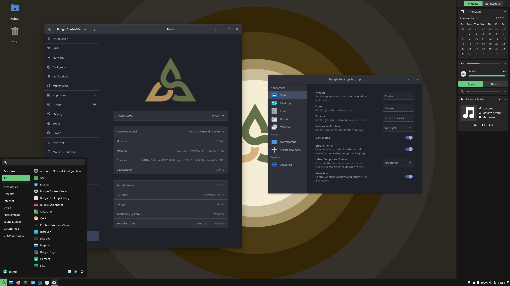
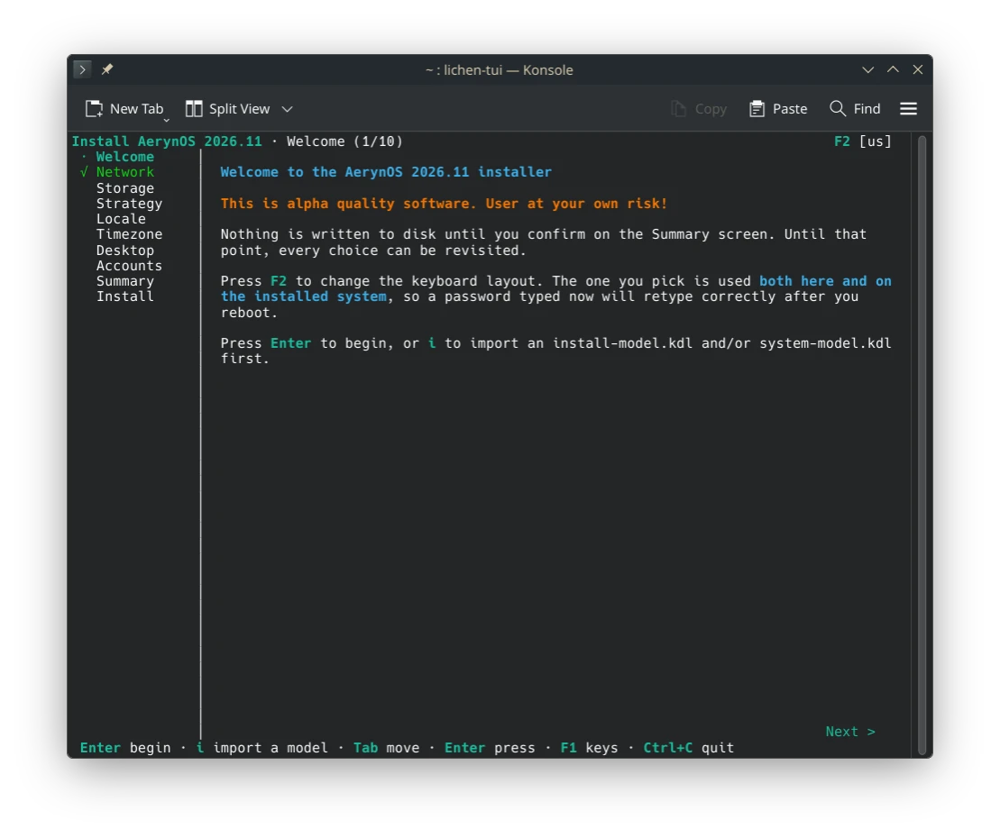
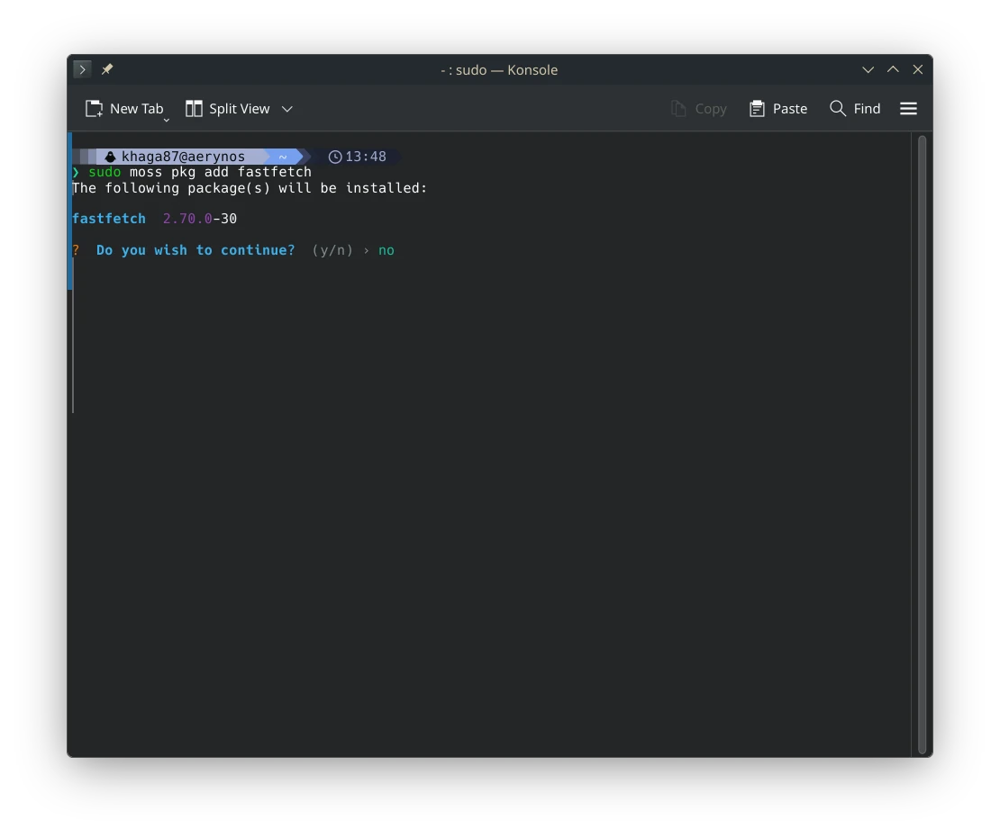
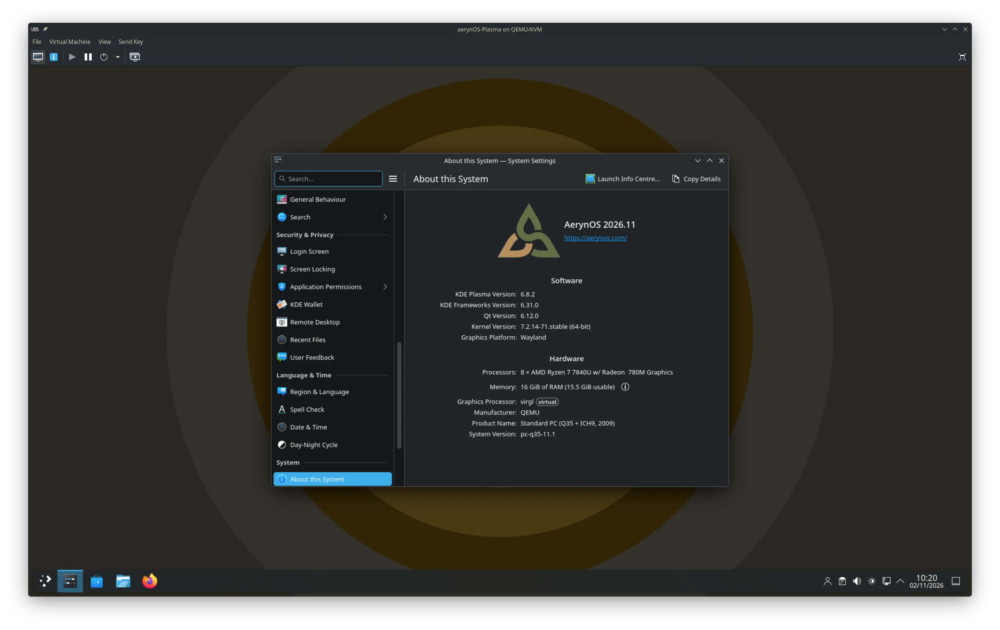

It's been a couple of months since our last update and there has been quite a lot going on. With the project having spent the last 18 months shoring up its foundations, we are now able to start shifting towards more open and collaborative development.

We have landed our new `moss` [command-line structure](/blog/2026/11/01/more-choice-and-developing-tooling/#a-new-command-structure-for-moss), which is a pretty significant departure from old CLI organization. The commands for adding and removing both repositories and packages from the internal `system-model` have changed so early adopters will need to adjust their mental model of how `moss` operates. It's a "breaking change" we are making now whilst aerynOS is still in development and better aligns the command convention to how `moss` is intended to work.

Budgie Desktop is now offered as an option for aerynOS early adopters, including as an install time option within our installer(s). Whilst we are still heavily in development, we are now at a point where we can offer multiple different Desktop Environments and a dozen Wayland Compositor options for those that want to "Build You Own Desktop". 

We have a new [2026.11](/download) ISO being released this month along side this blog post. It includes our existing installer but also a secondary option [`lichen-installer`](/blog/2026/11/01/more-choice-and-developing-tooling/#the-new-lichen-installer). Whilst it's not yet ready to be our default and only installer, is being added to the ISO for wider testing purposes. This newer installer takes care of drive partitioning and has a number of under the hood enhancements that will make aerynOS installation more robust. It is still Work in Progress and does not yet support disk encryption, dual booting or other features that might indicate aerynOS is daily driver ready. It does however pave the way for those features to be added in the future.

A smaller but important request was for [fwupd](/blog/2026/11/01/more-choice-and-developing-tooling/#firmware-updates-with-fwupd), which we have also now landed in our repository to ease hardware firmware updates for early adopters using aerynOS.

Lastly, we have also been doing housekeeping on our web presence. We have consolidated our websites to a single primary [aerynos.com](https://aerynos.com/) site and updating the content to better reflect our current project status. This is not the full website rebrand work, that is still happening in the background. However, we felt the existing website needed to be updated to better reflect the current position of aerynOS in the meantime.

<!-- excerpt -->

## What's new in the distro

### Introducing Jared and Kingfisher

We’d like to extend a huge official welcome, and thank you, to newest team members [Jaredy89](https://github.com/Jaredy899) and [K1ngfish3r](https://github.com/k1ngfish3r)!

Firstly, some words from Jaredy89:

> I didn’t come to Solus or aerynOS as a developer. I started contributing to Chris Titus Tech’s `linutil`, noticed Solus’s eopkg wasn’t represented, and added it. That led to packaging for Solus, then to updating packages already there.
> 
> A lot of what I learned, I’ll admit, came from cheating off Reilly’s commits to aerynOS and adapting them for Solus. He returned the favor by converting me. I now have over a thousand commits to each.
> 
> These days I keep most of our packages up to date and help new packagers learn how we package on aerynOS. My day job is a long way from this: I work with people experiencing early onset psychosis. I’m not a programmer by profession, but I like learning, and I like putting that toward a distribution I actually want to run.

And some words from K1ngfish3r:

> I was one of the daily drivers of Clear Linux. (The very same that was run by Intel). My foray into diagnosing and fixing bugs came from my desire to game and do "relatively" gamer stuff on CL. I contributed several fixes as well as new packages and got to see CL gain some traction as something other than just as a bench topper on phoronix. What I didn't realize at the time I joined was that CL was already in a downward spiral. The signs were there yet I had chosen to ignore them as I fell in love with the design of the distro and the small community we had.
>
> Alas, the EOL notice had finally come, and I had to make a switch. The closest distro which followed CL's ideas and principles were Solus and aerynOS. I picked aerynOS and my desire to game and and do "relatively" gamer stuff whilst contributing to this community has led me to become what I am today. Hope to keep contributing to this community for a long time.

Both Jaredy89 and K1ngfish3r started off as community members and eventually were promoted to Trusted Contributors and then Trusted Maintainers as they proactively stepped up to support our packaging efforts. We are really glad to have them both on board more formally as staff, with their presence having already been felt in the most positive of ways!

### Package and stack updates

There has been plenty of activity across the desktop and system stacks. Alongside the desktop updates, we've continued updating our kernels, graphics stack, compiler toolchains and the supporting libraries that make up the distribution.

Some of the package highlights include:

* COSMIC 1.11.0 with COSMIC Viewer
* GNOME 51.1
* KDE Plasma 6.8.2
* Budgie 10.10.4
* Hyprland 0.57
* Mango 0.18.4
* Miriway 26.10
* Noctalia 5.4.1
* Linux 7.2.14 & 6.18.60 LTS
* Mesa 26.2.6
* Firefox 159
* QEMU 11.1.3
* PipeWire 1.6.11
* Thunderbird 159
* Wine 11.21


Alongside the above, there have been many other updates, additions and rebuilds across the repository.

### Desktop Updates

#### Existing Desktop updates

We have landed [GNOME 51](https://release.gnome.org/51/) into the aerynOS repositories, with it now acting as the base of our latest ISO Live Environment.

We've now landed [COSMIC 1.11](https://github.com/pop-os/cosmic-epoch/releases/tag/epoch-1.11.0), together with updates to the wider COSMIC stack. We're particularly pleased to see **COSMIC Viewer** included. This application was created by our own staff member Bryan Hyland, who worked with the System76 team on the project. It's great to see his work become part of the wider COSMIC experience and available to more people.

We have also added [KDE Plasma 6.8](https://kde.org/announcements/plasma/6/6.8.0/) series, currently at [6.8.2](https://kde.org/announcements/plasma/6/6.8.2/) specifically.

As usual, if you notice any issues, please report them as issues in our recipes [repository](https://github.com/aerynOS/recipes/issues/new/choose).

#### Budgie Desktop

On top of the updates to our current Desktop offerings, we have worked with [Joshua Strobl](https://joshuastrobl.com/), lead of Budgie Desktop to bring [Budgie 10.10.4](https://buddiesofbudgie.org/blog/budgie-10-10-4-released) to aerynOS with it now also being offered as an install time option from lichen in our latest ISO. 

We value the opportunity to work directly with upstream project teams. It helps us identify issues early, distinguish between packaging problems and upstream issues, and contribute fixes in the right place.



#### Expanding Wayland Compositor options

Outside of the traditional Desktop Environments, we have also been increasing the number of Wayland Compositor options we have available. In total, we have around a dozen Wayland Compositors available within our repositories for those that want to Build their own desktop environment.

### Firmware updates with fwupd

[`fwupd`](https://github.com/fwupd/fwupd) is a relatively small addition to our repository, but an important one for improving the experience of using aerynOS on supported hardware.

We've previously been cautious about adding capabilities that might give the impression that aerynOS is a stable, daily driver ready distribution. However, as our early adopter community grows, it makes sense to address some of the practical limitations that make testing the distribution harder than it needs to be.

`fwupd` and the [Linux Vendor Firmware Service (LVFS)](https://fwupd.org/) are great initiatives, ones we wholehearted support. They provide an open approach to delivering firmware updates on Linux, and we're pleased to make this available to our early adopters.

## Infrastructure and Tooling Updates

### The new lichen installer



We have continued work on our updated `lichen-installer` and have now added it to our repository. We aren't yet at the point of using it as the default installer on our ISOs, so for our next ISO release, we are including both the current `lichen` and new `lichen-installer` to give early adopters the choice of which installer they would prefer to use. 

```bash
sudo lichen #old installer
lichen-tui #new installer
```

You can provide feedback on the new installer through our Zulip community through the dedicated [topic](https://aerynos.zulipchat.com/#narrow/channel/544170-Feedback/topic/FEEDBACK.20WANTED.20-.20New.20Installer/with/635873952) we have set up for it.

The new installer is a substantial step forward from our current, deliberately basic installation experience. The new installer provides a more interactive process while giving us a better foundation for adding capabilities over time.

It builds on our system-model approach to define which packages should be installed. We've extended this with a new install-model format, which also allows installation-time configuration such as locale and keyboard layout to be described in a KDL file.

Some of the improvements include:

1. Configuring Wi-Fi and keyboard layouts during installation, with those settings carried forward into the installed system.
2. Using your own `system-model.kdl` file to define the packages you want installed.
3. Supporting Btrfs root partitions, including a separate `@home` subvolume.
4. Automatically formatting installation drives, rather than requiring users to prepare their partitions beforehand.
5. A more refined TUI experience, with improvements to navigation, progress reporting and rendering.

The underlying work also gives us room to add further filesystem options and configuration screens as they become necessary.

### A new command structure for moss

One of the larger changes to our core tooling is the restructuring of the `moss` command-line interface. This workstream encompasses two separate deliverables:

1. Converting from the clap builder pattern to the clap derive pattern
2. Changing the mental model of moss commands to better align to our system-model approach

#### What's clap and why do we care?!

[Clap](https://github.com/clap-rs/clap) is the Rust library we use for building the command-line structure for our tooling (`moss` and `boulder` for example). 

In the back-end, we use clap to define the available commands and subcommands that moss has available along with any arguments and flags. There are two ways to define this command-line structure, the `builder` approach and the `derive` approach.

Simply put, the `builder` approach is a more imperative way of building a CLI where we explicitly build up the code to define each command, subcommand, argument and flag. For smaller and simpler CLIs this is not really an issue. However as a CLI grows, this becomes quite a large and verbose codebase in of itself.

By contrast, the `derive` approach is a more declarative way of building a CLI. We describe the CLI using Rust structs, enums and attributes. From there, Clap generates the necessary CLI code. This declarative approach leads to less boilerplate, easier code maintenance and better type safety. Aside from these benefits, we are using Clap `derive` to include documentation within the Rust code itself which can be used for better descriptions within `--help` commands when working with the CLI itself.

Clap `builder` served us well, when getting the Rust version of `moss` off the ground. Now that we are moving `moss` towards a more refined package manager, moving to Clap `derive` will allow for simpler and easier to maintain code with better documentation to go with it.

#### Changing the moss command structure itself

Over the last 18 months, we have been building out a more declarative system-model approach to how `moss` operates. Hence, we have now taken the opportunity to change the command-line-interface (CLI) structure to better reflect the system-model approach that the tooling is using.



- `sudo moss repo...`: You can add to, and remove, enable, and disable repositories from your system-model, and also update the system's cached view of these repositories
- `sudo moss package...`: You can add packages to, or remove packages from, your system-model, and sync said changes to your system install. If you have declaratively defined your system-model, these commands do not change the underlying system-model, but instead create and modify a transient system-model that stays active until you sync to your declared system-model again. This is similar in spirit to how Nix works, but not in the details.
- `sudo moss sync -u`: Update the cached view of your enabled repositories, then sync your system install with the state of these repositories based on the resolution of your system-model

The subcommands used above are derived from an accurate description of how the relevant subcommands edit or resolve the system-model representing an aerynOS install.

So even though `moss` supports being operated as if it were a traditional, imperative package manager, we would be doing users a disservice if we were to pretend that it works the same way as the imperative package managers within the Linux ecosystem that users may be used to.

Hence the very deliberate choice of verbs to describe the actions being performed, with the choices intended to aid in understanding what the subcommands do behind the scenes and why. We understand that this may require a bit of retraining, but we also assume that early adopters operating the `moss` CLI in its current state are the curious and inventive sort, who don't mind encountering and absorbing new and helpful abstractions if it helps them accurately and predictably control their system's installed state.

Note that the new user facing CLI is still WiP itself with a few feature still unimplemented. However, it is sufficiently far along in its development that we are including it now, and we will continue to refine it going forward.

#### What else will this enable

The Clap `derive` approach will simplify the process of developing our command structure as / when we need to add new functionality. It unblocks the `moss search` rework that has been progressing in the background where we will look to combine `moss search` and `moss file-search` and it will also allow us to enable shell completions for further supporting our testers getting to grips with the command structure. 

We have already implemented command aliases for those who might not be happy at having to type more for these commands:

- `sudo moss pad`: package add
- `sudo moss prm`: package remove
- `sudo moss pif`: package info
- `sudo moss rad`: repo add
- `sudo moss rrm`: repo remove

*There are other aliases which can be found by using the `--help` option*

We've also improved the help output and error handling around `moss` usage. The aim is to make using `moss` an overall more consistent and refined experience so giving better quality feedback when commands aren't entered quite right. A new `moss tree` command can also generate a full view of the command hierarchy, including examples and documentation, to make the available functionality easier to understand.

## ISO refresh



We're releasing a new aerynOS 2026.11 ISO alongside this month's blog post.

As mentioned above, the live ISO is based on GNOME 51, comes with all the latest packages and Linux 7.2.14 kernel and includes both our existing `lichen` installer but also our new `lichen-installer`, allowing you to use either for installing aerynOS. Whilst the new installer will take care of auto-partitioning your drive and have other fix up's under the hood, if you experience any issues, please do report them back in the lichen-installer [repository](https://github.com/aerynOS/lichen-installer/issues).

We have added Budgie as an install time option to both installers, bringing our Desktop selection up to 4 (Budgie, COSMIC, GNOME and KDE Plamsa) from within the installer itself. We have, however, removed the terminal-only and headless options. These may come back at a later stage, however we found users trying these terminal only options were disproportionately seeking support even though these options were flagged as expert only options.

<div style="display: flex; justify-content: center; align-items: center; padding: 20px 50px;">
  <a style="font-weight: bold; color: white; background-color: #626f47ff; padding: 10px 20px; text-decoration: none; text-align: center; border-radius: 5px;" href="/download/">
    Download aerynOS
  </a>
</div>

## Wider Project Updates

### Bringing our websites together

Over the course of the year, we have been working on a brand new website. We don't want to rush this work but it is not ready yet. This left us in a position where our existing website was very outdated.

We took the step to consolidate our existing websites, [aerynos.com](https://aerynos.com/) and [aerynos.dev](https://aerynos.dev/), and update the front pages (home, about and tooling) to more accurately reflect the project's current status.

We will continue working on the new website in the background, but for now, our web presence more accurately reflects the project and its current level of development so as to not mislead any potential early adopters.

## Next Steps

Work will continue around our new `lichen-installer` with the aim for it to land in the next ISO as our default install option. Your help in testing it out and providing feedback via Zulip is always welcome in this regard!

Discussion is ongoing around the next development cycle of `moss`. The current approach has served us well until now, but as the project matures, so must the codebase towards a stable, quality product.

Aside from this, the new `moss` command structure work paves the way for refining our `moss search` functionality and CLI completion approach.

## Supporting the Project

If you would like to support the project, there are many ways you can get involved.

You can help with packaging, documentation, testing, code development or simply by using aerynOS and reporting issues when you encounter them.

You can also join our community on Zulip or Discourse and help us continue growing the project.

Outside of this, you can support the project financially through one of our supported sponsorship platforms.

<div style="display: flex; justify-content: center; align-items: center; padding: 20px 50px;">
  <a style="font-weight: bold; color: white; background-color: #626f47ff; padding: 10px 20px; text-decoration: none; text-align: center; border-radius: 5px;" href="/sponsor/">
    Sponsor aerynOS
  </a>
</div>

We are always open to engagement with hardware vendors and infrastructure partners around the open source community. If you would like to get in touch to discuss sponsorship opportunities, please reach out to us at [contact@aerynos.com](mailto:contact@aerynos.com).

## Thank You!

We are very grateful for your support, be it financial or via project contributions in the form of carefully written bug reports, code contributions, design contributions, documentation updates, general feedback, package updates and overall enthusiasm around the project.

We hope that you will continue showing enthusiasm for our project, and that you will want to get involved in whichever way, shape, or form works for you!
